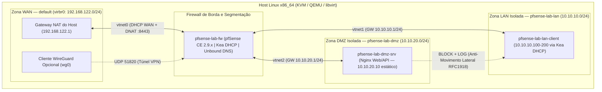

# pfsense-kvm-iac — Infraestrutura de Segurança de Borda e Microssegmentação como Código


-212121?logo=freebsd&logoColor=white)


Laboratório reprodutível de **Engenharia de Segurança de Redes e Infraestrutura como Código (IaC)** sobre **KVM/QEMU + `libvirt`**, projetado para provisionar, endurecer (*hardening*) e validar automaticamente uma arquitetura corporativa de **três zonas de segurança (`WAN`, `LAN` e `DMZ`)** controlada pelo **pfSense Community Edition (CE) 2.9.x** 100% *open source*.

O projeto combina provisionamento declarativo com **OpenTofu**, bootstrap sem segredos versionados via **External Configuration Locator (ECL)** no pfSense e **cloud-init (`NoCloud`)** nos nós Linux, gerência de configuração com **Ansible** e verificação contínua de políticas de firewall (*Default Deny*, prevenção de movimento lateral, Split-DNS e DNAT) com **BATS**.

---

## Sumário

1. [Visão Geral e Objetivos Arquiteturais](#1-visão-geral-e-objetivos-arquiteturais)
2. [Topologia de Rede e Especificação das VMs](#2-topologia-de-rede-e-especificação-das-vms)
3. [Pilares de Engenharia e Hardening Aplicados](#3-pilares-de-engenharia-e-hardening-aplicados)
4. [Estrutura do Repositório](#4-estrutura-do-repositório)
5. [Pré-requisitos do Host](#5-pré-requisitos-do-host)
6. [Guia Passo a Passo de Execução (Quickstart)](#6-guia-passo-a-passo-de-execução-quickstart)
7. [Matriz Automatizada de Testes de Segurança](#7-matriz-automatizada-de-testes-de-segurança)
8. [Referência de Comandos (`Makefile`)](#8-referência-de-comandos-makefile)
9. [Qualidade, DevSecOps e Pipeline de CI](#9-qualidade-devsecops-e-pipeline-de-ci)
10. [Guia de Troubleshooting](#10-guia-de-troubleshooting)
11. [Licença](#11-licença)

---

## 1. Visão Geral e Objetivos Arquiteturais

Ambientes tradicionais de laboratório de firewall frequentemente sofrem de **configuração manual (*ClickOps*)**, dependência de snapshots binários pesados (`.qcow2`/`.ova`), credenciais fixas versionadas em repositórios e ausência de testes automatizados de regressão de regras.

O **`pfsense-kvm-iac`** resolve esses problemas tratando toda a topologia de segurança como código auditável e efêmero:

* **100% Open Source:** Baseado exclusivamente no **pfSense CE 2.9.x** (FreeBSD 16.0-CURRENT) e pacotes comunitários abertos (`System_Patches`, `pfBlockerNG`, `HAProxy`, `WireGuard` e `Suricata` com regras *Emerging Threats Open*), sem qualquer dependência de recursos proprietários.
* **Isolamento Seguro no Host:** Reutiliza a rede NAT pré-existente `default` (`virbr0`) apenas como enlace externo de **WAN**, isolando todos os volumes, ISOs `NoCloud` e overlays `.qcow2` em um *storage pool* dedicado (`pfsense-lab-pool`) e redes virtuais exclusivas (`pfsense-lab-*`). O comando `make destroy` remove unicamente os artefatos do projeto.
* **Zero Segredos no Git:** Chaves SSH `ed25519`, chaves `WireGuard`, Autoridade Certificadora (CA) local, certificados TLS e hashes `bcrypt` são gerados em tempo de execução em `secrets/` (ignorado pelo Git e auditado por `gitleaks`).
* **Validação Orientada a Provas:** As políticas de segmentação não são apenas aplicadas — são provadas por uma suíte automatizada (`tests/firewall_matrix.bats`) que testa fluxos permitidos e tentativas reais de movimento lateral entre zonas.

---

## 2. Topologia de Rede e Especificação das VMs

### Diagrama de Arquitetura e Fluxos de Controle



### Zonas de Rede no `libvirt`

| Zona | Rede no `libvirt` | Sub-rede CIDR | Gateway | Modo no Hipervisor | Serviços de Endereçamento e Nome |
| :--- | :--- | :--- | :--- | :--- | :--- |
| **WAN** | `default` *(pré-existente)* | `192.168.122.0/24` | `192.168.122.1` | NAT (`virbr0`) | `dnsmasq` nativo do host (intocado) |
| **LAN** | `pfsense-lab-lan` | `10.10.10.0/24` | `10.10.10.1` | Isolada (L2 puro, sem `forward`/`dhcp` do host) | pfSense **Kea DHCP** (`10.10.10.100–200`) + **Unbound DNS** |
| **DMZ** | `pfsense-lab-dmz` | `10.10.20.0/24` | `10.10.20.1` | Isolada (L2 puro, sem `forward`/`dhcp` do host) | pfSense **Kea DHCP** (reserva fixa `10.10.20.10`) + **Unbound DNS** |

### Inventário de Máquinas Virtuais

| Domínio (`libvirt`) | Papel Arquitetural | vCPU | RAM | Disco (`.qcow2` Thin) | Interfaces VirtIO (Ordem Estrita de PCI) | Bootstrap |
| :--- | :--- | :---: | :---: | :---: | :--- | :--- |
| `pfsense-lab-fw` | Firewall NGFW, Roteador, NAT, DNS e DHCP | 2 | 2048 MiB *(4096 MiB c/ IDS)* | 20 GiB | `vtnet0`: `default` (WAN), `vtnet1`: `pfsense-lab-lan`, `vtnet2`: `pfsense-lab-dmz` | Auto (ZFS) + Volume **ECL** (`config.xml`) |
| `pfsense-lab-lan-client` | Estação administrativa e bastião de testes | 2 | 2048 MiB | 15 GiB | `eth0`: `pfsense-lab-lan` (MAC determinístico) | Cloud Image + `cloud-init` (`NoCloud`) |
| `pfsense-lab-dmz-srv` | Servidor Web/API exposto de forma controlada | 1 | 1024 MiB | 10 GiB | `eth0`: `pfsense-lab-dmz` (MAC fixo `52:54:00:20:00:10`) | Cloud Image + `cloud-init` (`NoCloud`) + Ansible |

---

## 3. Pilares de Engenharia e Hardening Aplicados

### 3.1. OpenTofu + Provider `dmacvicar/libvirt` `v0.9.x` (*Schema-First*)
A série `0.9.x` do provider `dmacvicar/libvirt` substituiu o schema legado das versões `0.7/0.8` por uma modelagem gerada diretamente da especificação XML oficial do `libvirt`. Os módulos em `tofu/modules/` seguem estritamente o schema `~> 0.9.9` (documentado em `docs/adr/001-opentofu-libvirt-09.md`), utilizando *backing stores* somente leitura de Cloud Images oficiais com *overlays* Copy-on-Write em `.qcow2`, permitindo recriar os nós Linux em poucos segundos.

### 3.2. Injeção Declarativa via *External Configuration Locator* (ECL)
Em vez de automatizar cliques na WebGUI ou versionar um `config.xml` com hashes reais, o script `scripts/build-ecl-image.sh` combina o template parametrizado `pfsense/config.xml.tmpl` com os segredos efêmeros gerados em `secrets/` via `envsubst`, valida a sintaxe XML com `xmllint --noout` e empacota uma imagem de volume (`config/config.xml`) anexada à VM `pfsense-lab-fw`. No boot, o subsistema ECL do pfSense importa automaticamente toda a topologia, certificados, usuários e regras.

### 3.3. Correção de *Hardware Checksum Offloading* (`vtnet` em KVM/FreeBSD)
Em ambientes virtualizados KVM utilizando interfaces paravirtualizadas VirtIO (`vtnet`), a delegação de cálculo de checksum TCP/UDP na bridge virtual faz com que o filtro de pacotes `pf` do FreeBSD descarte segmentos legítimos com erro de checksum inválido. O template ECL aplica nativamente desde o primeiro boot:
* `disablechecksumoffloading` (Hardware Checksum Offloading desativado)
* `disablesegmentationoffloading` (TSO desativado)
* `disablelargereceiveoffloading` (LRO desativado)

### 3.4. Hardening de Mercado e Microssegmentação *Zero-Trust*
* **Gerência Blindada:** Conta padrão `admin` **desabilitada**; criação de usuário nominal parametrizado autenticado por hash `bcrypt` na WebGUI (estritamente **HTTPS** com certificado assinado pela CA local do laboratório) e exclusivamente por chave pública `ed25519` no SSH (`sshdkeyonly`). Zero exposição de portas administrativas na `WAN` e na `DMZ`.
* **Kea DHCP & Unbound DNSSEC:** Uso do motor moderno **Kea DHCP** (substituindo o ISC DHCP legado/descontinuado) integrado ao **Unbound DNS Resolver** em modo iterativo com **DNSSEC** habilitado e *Host Override* interno (`app.lab.local -> 10.10.20.10`) para resolução *Split-Horizon*.
* **Contenção de Movimento Lateral (`DMZ -x-> RFC1918`):** Caso o servidor exposto na DMZ (`10.10.20.10`) seja comprometido, uma regra explícita de **BLOCK + LOG** no topo da interface `DMZ` impede conexões para o alias `RFC1918` (`10.0.0.0/8`, `172.16.0.0/12`, `192.168.0.0/16`), isolando completamente a `LAN` e a rede interna do host, liberando apenas consultas DNS estritas ao gateway da DMZ (`10.10.20.1:53`) e tráfego de atualização controlado.
* **Publicação Controlada (DNAT):** Redirecionamento de porta na `WAN` (`TCP 8443 -> 10.10.20.10:80`) acoplado à regra de filtro restrita exclusivamente ao serviço Nginx da DMZ.

---

## 4. Estrutura do Repositório

```text
pfsense-kvm-iac/
├── AGENTS.md                        # Guardrails arquiteturais e operacionais para agentes e contribuidores
├── SPEC.md                          # Especificação técnica canônica e marcos de engenharia
├── README.md                        # Documentação técnica, guia de operação e troubleshooting
├── LICENSE                          # Licença MIT
├── Makefile                         # Orquestrador unificado (doctor, init, up, provision, test, lint, destroy)
├── .gitignore                       # Bloqueio de segredos, imagens (.iso/.qcow2) e estados locais
├── .pre-commit-config.yaml          # Hooks locais (gitleaks, shellcheck, tofu fmt/validate, tflint, ansible-lint)
├── .github/workflows/ci.yml         # Pipeline CI/CD executável em runners públicos sem KVM
├── docs/
│   ├── architecture.md              # Detalhamento de fluxos de pacotes, NAT e zonas de confiança
│   └── adr/                         # Architecture Decision Records
│       ├── 001-opentofu-libvirt-09.md
│       ├── 002-pfsense-ce-zfs-and-vtnet-offload.md
│       └── 003-ecl-config-templating.md
├── tofu/
│   ├── versions.tf                  # Pinagem OpenTofu >= 1.8 e dmacvicar/libvirt ~> 0.9.9
│   ├── providers.tf                 # Conexão parametrizada com qemu:///system
│   ├── variables.tf                 # Variáveis tipadas com validações de CIDR, recursos e caminhos
│   ├── terraform.tfvars.example     # Modelo pronto para cópia e edição com vim
│   ├── main.tf                      # Orquestração modular da topologia
│   ├── outputs.tf                   # Exportação estruturada JSON para inventário Ansible e testes
│   └── modules/
│       ├── network/                 # Redes isoladas pfsense-lab-lan e pfsense-lab-dmz
│       ├── storage/                 # Pool dedicado pfsense-lab-pool (0711) + backing/overlay volumes
│       ├── pfsense/                 # Domínio pfsense-lab-fw (host-passthrough, 3 NICs VirtIO, ISO + ECL)
│       └── linux-node/              # Nós Linux genéricos provisionados via cloud-init NoCloud
├── pfsense/
│   ├── config.xml.tmpl              # Template declarativo sanitizado do pfSense CE 2.9.x
│   └── README.md                    # Guia de obtenção e validação criptográfica da ISO oficial
├── ansible/
│   ├── ansible.cfg                  # Configuração SSH efêmera (chaves em secrets/ e ProxyJump)
│   ├── inventory/                   # Inventário dinâmico derivado de `tofu output -json`
│   ├── playbooks/
│   │   ├── site.yml                 # Provisionamento idempotente da DMZ e da LAN
│   │   └── verify.yml               # Verificações auxiliares de estado dos serviços
│   └── roles/
│       ├── dmz_web/                 # Servidor Nginx endurecido + endpoint JSON/HTTP /health
│       └── lan_client/              # Ferramental de auditoria (curl, dig, nmap, tcpdump, wireguard-tools, vim)
├── scripts/
│   ├── doctor.sh                    # Diagnóstico pré-voo do host KVM, binários, espaço e SHA256
│   ├── gen-secrets.sh               # Geração local de chaves SSH, WireGuard, CA TLS e bcrypt em secrets/
│   └── build-ecl-image.sh           # Renderização segura do config.xml e criação do volume ECL
└── tests/
    └── firewall_matrix.bats         # Suíte automatizada de testes de aceitação de conectividade e bloqueio
```

---

## 5. Pré-requisitos do Host

### Requisitos de Sistema e Virtualização
* **Sistema Operacional:** Distribuição Linux `x86_64` moderna (homologado em **Ubuntu 24.04 / 26.04 LTS** ou Debian 12/13).
* **CPU & Virtualização:** Suporte de hardware Intel VT-x ou AMD-V habilitado na BIOS/UEFI (`/dev/kvm` ativo) e IOMMU recomendado; mínimo recomendado de **4 threads livres** e **8 GiB de RAM livre** no host (~5 GiB consumidos pelas 3 VMs simultâneas).
* **Armazenamento:** Mínimo de **50 GiB livres** na partição de `/var/lib/libvirt/images` (o uso real inicial com *thin provisioning* é inferior a 8 GiB).
* **Permissões `libvirt`:** Usuário atual membro dos grupos `kvm` e `libvirt`, com acesso sem `sudo` ao daemon `qemu:///system`, além da rede NAT `default` ativa.

### Ferramentas de Linha de Comando

| Categoria | Binários Necessários | Versão Alvo |
| :--- | :--- | :--- |
| **Virtualização & Imagens** | `virsh`, `virt-host-validate`, `xorriso`, `qemu-img` | QEMU `>= 8.x` / `libvirt >= 10.x` |
| **Infraestrutura & Config** | `tofu` (OpenTofu), `ansible`, `ansible-playbook` | OpenTofu `>= 1.8`, `ansible-core >= 2.17` |
| **Utilitários Base** | `make`, `bash`, `jq`, `envsubst` (`gettext-base`), `openssl`, `ssh`, `vim` | Padrão do sistema |
| **Testes & Qualidade** | `bats`, `shellcheck`, `xmllint` (`libxml2-utils`), `tflint`, `checkov`, `ansible-lint`, `gitleaks`, `pre-commit` | Atual |

> **Nota de Permissão de Grupos (Ubuntu/Debian):** Caso seu usuário ainda não pertença aos grupos `kvm` e `libvirt`, adicione-o uma única vez com `sudo usermod -aG kvm,libvirt "$USER"` e reinicie a sessão de login antes de prosseguir.

---

## 6. Guia Passo a Passo de Execução (Quickstart)

### Passo 1 — Clonar o Repositório e Validar o Host

```bash
git clone https://github.com/<SEU_USUARIO>/pfsense-kvm-iac.git
cd pfsense-kvm-iac
make doctor
```

O script [`scripts/doctor.sh`](scripts/doctor.sh) inspeciona `/dev/kvm`, grupos do usuário, `virt-host-validate qemu`, conectividade com `qemu:///system`, preservação da rede/pool `default`, versões de `tofu` e `ansible`, espaço em `/var/lib/libvirt/images` e integridade das ISOs.

### Passo 2 — Obter e Verificar a ISO Oficial do pfSense CE 2.9.x

Por conformidade de licenciamento e higiene de repositório, imagens `.iso` nunca são versionadas no Git.

1. Acesse o portal oficial de downloads da Netgate/pfSense (`https://www.pfsense.org/download/`) ou o mirror público oficial de imagens **pfSense Community Edition (CE)** para arquitetura **AMD64 (`x86_64`)** — instalador ISO (`dvd` / serial ou Netgate Installer).
2. Baixe o arquivo da imagem (`.iso` ou `.iso.gz`) **e** o respectivo arquivo oficial de checksum `.sha256` para o diretório local `isos/`:

```bash
mkdir -p isos
# Se o arquivo vier compactado em .gz, descomprima mantendo o .sha256 correspondente da imagem:
# gunzip -k isos/pfSense-CE-2.9.2-RELEASE-amd64.iso.gz
# Salve ou gere a referência oficial em isos/<nome-da-imagem>.iso.sha256
```

3. Reexecute o diagnóstico para validar criptograficamente o hash SHA256 da imagem:

```bash
make doctor
```

### Passo 3 — Configurar Parâmetros Locais com `vim`

Copie o arquivo de exemplo de variáveis do OpenTofu e ajuste conforme seu ambiente utilizando o `vim` (por exemplo, nome exato da ISO em `isos/`, quantidade de RAM caso deseje habilitar o `Suricata` com 4096 MiB ou customização de usuário administrativo):

```bash
cp tofu/terraform.tfvars.example tofu/terraform.tfvars
vim tofu/terraform.tfvars
```

### Passo 4 — Inicializar Providers, Segredos Efêmeros e Imagem ECL

```bash
make init
```

Este alvo executa sequencialmente:
1. `scripts/gen-secrets.sh`: gera em `secrets/` (com permissões restritas `0600`) o par de chaves SSH `ed25519` (`lab_ed25519`), a CA raiz e o certificado TLS da WebGUI, o hash `bcrypt` da senha administrativa e os pares de chaves `WireGuard`.
2. `scripts/build-ecl-image.sh`: renderiza `pfsense/config.xml.tmpl` em memória/diretório seguro, valida o XML com `xmllint --noout` e constrói o volume ECL contendo `/config/config.xml`.
3. `tofu -chdir=tofu init`: baixa e valida o provider `dmacvicar/libvirt` (`~> 0.9.9`).

### Passo 5 — Subir a Infraestrutura Virtual (`make up`)

```bash
make up
```

O OpenTofu criará:
* O storage pool isolado `pfsense-lab-pool` (`/var/lib/libvirt/images/pfsense-lab` com modo `0711`, compatível com o perfil AppArmor do `libvirt-qemu`);
* As redes L2 isoladas `pfsense-lab-lan` (`10.10.10.0/24`) e `pfsense-lab-dmz` (`10.10.20.0/24`);
* Os nós Linux `pfsense-lab-lan-client` e `pfsense-lab-dmz-srv` via *Cloud Images* + `cloud-init`;
* O firewall `pfsense-lab-fw` com CPU `host-passthrough` (expondo instruções **AES-NI** ao FreeBSD), 3 NICs VirtIO ordenadas, ISO de instalação e volume ECL acoplado.

#### Instalação Inicial do pfSense CE em Auto (ZFS)
No primeiro provisionamento do disco vazio do firewall:
1. Conecte-se ao console serial ou gráfico da VM (`virsh -c qemu:///system console pfsense-lab-fw` ou `virt-viewer -c qemu:///system pfsense-lab-fw`).
2. Aceite o instalador padrão selecionando **Install pfSense** -> **Auto (ZFS)** -> disco virtual `vtbd0`.
3. Ao concluir a cópia dos pacotes, confirme o **Reboot** (e remova/desative o boot por CD-ROM se solicitado ou reaplique `make up` com `install_iso_enabled = false` em `vim tofu/terraform.tfvars`).
4. Durante o primeiro boot pós-instalação, o **External Configuration Locator (ECL)** detectará automaticamente o volume de configuração e aplicará todas as interfaces, certificados, Kea DHCP, Unbound DNS e regras de firewall sem intervenção manual.

### Passo 6 — Provisionar Serviços na DMZ e Ferramentas na LAN

Com o firewall ativo e distribuindo leases Kea DHCP:

```bash
make provision
```

O Ansible consome dinamicamente a saída de `tofu output -json`, utiliza a estação `pfsense-lab-lan-client` como bastião (`ProxyJump`) quando aplicável e configura de forma idempotente:
* **`pfsense-lab-dmz-srv` (`10.10.20.10`):** Servidor **Nginx** endurecido respondendo na porta `80` com cabeçalhos de diagnóstico e endpoint `/health` (`HTTP 200 OK`).
* **`pfsense-lab-lan-client` (`10.10.10.x`):** Pacote completo de engenharia e auditoria (`curl`, `dig`, `nmap`, `tcpdump`, `ncat`, `wireguard-tools` e `vim`).

### Passo 7 — Executar os Testes Automatizados de Segurança

```bash
make test
```

### Passo 8 — Destruição Limpa e Isolada do Laboratório

Para encerrar o laboratório e remover exclusivamente os domínios, volumes e redes `pfsense-lab-*` (preservando 100% intactos a rede `default` e o pool `default` do seu host):

```bash
make destroy
```

---

## 7. Matriz Automatizada de Testes de Segurança

A suíte `tests/firewall_matrix.bats` valida empiricamente a postura de segurança da topologia por meio de conexões reais entre as zonas:

| ID | Caso de Teste | Origem → Destino | Protocolo / Alvo | Resultado Esperado e Objetivo de Segurança |
| :--- | :--- | :--- | :--- | :--- |
| **`T01`** | `T01_dmz_lateral_block` | `dmz-srv` → `lan-client` | `ICMP` e `TCP/22` | **BLOCK** — Comprova contenção contra movimento lateral da DMZ para sub-redes internas (`RFC1918`) com registro em log do `pf`. |
| **`T02`** | `T02_lan_to_dmz_web` | `lan-client` → `10.10.20.10` | `HTTP/80` (`/health`) | **PASS** (`200 OK`) — Valida roteamento inter-zonas controlado da LAN para serviços autorizados na DMZ. |
| **`T03`** | `T03_lan_to_wan_egress` | `lan-client` → Internet | `HTTPS/443` | **PASS** — Confirma NAT de saída (`Outbound NAT`), resolução DNS recursiva e ausência de corrupção de checksum `vtnet`. |
| **`T04`** | `T04_unbound_override` | `lan-client` → `10.10.10.1` | `DNS/53` (`app.lab.local`) | **PASS** (`10.10.20.10`) — Verifica o funcionamento do Unbound DNS Resolver com *Split-DNS* interno. |
| **`T05`** | `T05_wan_dnat_to_dmz` | Host Linux → IP WAN pfSense | `TCP/8443` (`/health`) | **PASS** (`200 OK`) — Valida regra de *Port Forward* (DNAT) publicando exclusivamente o serviço web da DMZ na borda WAN. |
| **`T06`** | `T06_wan_mgmt_closed` | Host Linux → IP WAN pfSense | `TCP/443` e `TCP/22` | **BLOCK** — Garante que a WebGUI administrativa e o daemon SSH do pfSense estão inacessíveis a partir da WAN. |
| **`T07`** | `T07_wireguard_tunnel` | Host (`wg0`) → `10.10.10.1` | `UDP/51820` + `ICMP` | **PASS** *(Fase Opcional)* — Valida handshake criptográfico WireGuard e acesso administrativo remoto seguro à LAN. |

---

## 8. Referência de Comandos (`Makefile`)

Todos os fluxos operacionais são padronizados através do [`Makefile`](Makefile) na raiz do projeto:

| Comando | Descrição Técnica |
| :--- | :--- |
| `make help` | Lista todos os alvos disponíveis e exibe o editor padrão configurado (`vim`). |
| `make doctor` | Executa [`scripts/doctor.sh`](scripts/doctor.sh) verificando KVM, grupos, `libvirt`, binários, disco e SHA256 da ISO. |
| `make init` | Gera segredos locais em `secrets/`, constrói a imagem ECL e inicializa os módulos OpenTofu. |
| `make up` | Aplica o plano OpenTofu (`tofu apply`) provisionando pool, redes isoladas e as 3 VMs. |
| `make provision` | Executa os playbooks Ansible configurando Nginx na DMZ e ferramentas de rede na LAN. |
| `make test` | Dispara a suíte de aceitação `bats` (`T01` a `T06`/`T07`) validando conectividade e bloqueios. |
| `make lint` | Roda análise estática completa (`shellcheck`, `tofu fmt`/`validate`, `tflint`, `xmllint`, `ansible-lint`, `gitleaks`). |
| `make destroy` | Destrói de forma limpa apenas os recursos `pfsense-lab-*` após confirmação explícita. |

---

## 9. Qualidade, DevSecOps e Pipeline de CI

Mesmo tratando-se de um projeto que utiliza hipervisor KVM local em tempo de execução, toda a base declarativa é auditada estaticamente antes de cada commit ([`.pre-commit-config.yaml`](.pre-commit-config.yaml)) e em integração contínua no GitHub Actions (`.github/workflows/ci.yml`, sem necessidade de runners com virtualização aninhada):

1. **Prevenção de Vazamento de Credenciais:** `gitleaks` varre commits e árvores de arquivos impedindo qualquer chave privada, certificado ou hash residual.
2. **Qualidade de Scripts Bash:** `shellcheck -x` garante conformidade POSIX/Bash segura em `scripts/*.sh` (`set -euo pipefail`).
3. **Integridade do Template pfSense:** `xmllint --noout` valida que o `config.xml` renderizado com variáveis de teste permanece 100% bem-formado.
4. **Conformidade e Segurança IaC:** `tofu fmt -check -recursive`, `tofu validate` (`-backend=false`), `tflint` e `checkov` auditam os módulos HCL.
5. **Idempotência de Configuração:** `ansible-lint` verifica boas práticas, módulos FQCN e permissões explícitas nas roles `dmz_web` e `lan_client`.

Para ativar os hooks localmente no seu clone:

```bash
pre-commit install
make lint
```

---

## 10. Guia de Troubleshooting

### 1. Erro `Permission denied` ao iniciar VMs no `libvirt` / AppArmor
* **Sintoma:** `tofu apply` falha ao anexar volumes `.qcow2` ou `.iso` com erro `Could not open '/var/lib/libvirt/images/pfsense-lab/...': Permission denied`.
* **Causa:** O processo `libvirt-qemu` precisa de permissão de travessia (`--x`, modo `0711`) em toda a hierarquia até o pool e de caminhos compatíveis com o perfil AppArmor `/etc/apparmor.d/abstractions/libvirt-qemu`. Nunca utilize imagens dentro do diretório `/home/<usuario>` diretamente anexadas ao `qemu:///system`, **nunca aplique `chmod 777`** e **não desabilite o AppArmor**.
* **Diagnóstico e Solução:**
  ```bash
  ls -ld /var/lib/libvirt/images /var/lib/libvirt/images/pfsense-lab
  dmesg | grep -i apparmor | tail -n 20
  ```
  Certifique-se de que todos os volumes e ISOs auxiliares (`cloud-init` e `ECL`) estejam declarados como recursos `libvirt_volume` dentro do `pfsense-lab-pool` (`/var/lib/libvirt/images/pfsense-lab`).

### 2. Ping (`ICMP`) funciona, mas `curl` / `HTTPS` / `SSH` travam ou sofrem timeout através do pfSense
* **Sintoma:** Pacotes ICMP atravessam o firewall normalmente, porém conexões TCP (`T02`, `T03` ou `T05`) congelam no *handshake* ou apresentam retransmissões constantes em `tcpdump -vvv`.
* **Causa:** *Hardware Checksum Offloading* ativo nas interfaces VirtIO (`vtnet`).
* **Solução:** Verifique em `pfsense/config.xml.tmpl` (seção `<system>`) a presença das tags `<disablechecksumoffloading/>`, `<disablesegmentationoffloading/>` e `<disablelargereceiveoffloading/>`, recrie o volume ECL (`./scripts/build-ecl-image.sh`) e reinicie o `pfsense-lab-fw`.

### 3. Teste `T05` (DNAT na WAN) bloqueado a partir do Host Ubuntu
* **Sintoma:** O host (`192.168.122.1`) tenta acessar `http://<IP_WAN_PFSENSE>:8443/health` e a conexão expira silenciosamente.
* **Causa:** Como a WAN do laboratório opera sobre a rede NAT privada do `libvirt` (`192.168.122.0/24`, pertencente à faixa `RFC1918`), a opção nativa **Block private networks and loopback addresses** (`<blockpriv/>`) na interface WAN bloquearia pacotes originados em `192.168.122.1`.
* **Solução:** No laboratório, mantenha `lab_allow_rfc1918_wan = true` em `vim tofu/terraform.tfvars`.
  > **Aviso Crítico para Produção:** Ao transpor este template para um appliance conectado a um link de Internet público real, defina obrigatoriamente `lab_allow_rfc1918_wan = false` para reativar o bloqueio anti-spoofing de redes privadas (`RFC1918`) e bogons na interface WAN.

### 4. Interfaces `WAN`, `LAN` e `DMZ` invertidas no pfSense
* **Sintoma:** O pfSense solicita IP DHCP na interface errada ou não responde em `10.10.10.1`.
* **Causa:** Alteração na ordem de declaração dos blocos de interface de rede no módulo `tofu/modules/pfsense`. O FreeBSD numera `vtnet0`, `vtnet1` e `vtnet2` estritamente pela ordem dos endereços de barramento PCI expostos pelo QEMU.
* **Solução:** Mantenha rigorosamente a ordem no domínio `pfsense-lab-fw`: 1º `default` (`vtnet0` -> WAN), 2º `pfsense-lab-lan` (`vtnet1` -> LAN), 3º `pfsense-lab-dmz` (`vtnet2` -> OPT1/DMZ).

### 5. Rotação Completa de Credenciais e Certificados do Laboratório
Caso deseje invalidar todas as chaves SSH, certificados TLS e senhas geradas anteriormente:

```bash
rm -rf secrets/
./scripts/gen-secrets.sh
./scripts/build-ecl-image.sh
```

Em seguida, reaplique a infraestrutura com `make up && make provision`.

---

## 11. Licença

Distribuído sob a licença **MIT**. Consulte o arquivo [LICENSE](LICENSE) para mais detalhes.
